# M05-06 — Un agente visual con n8n

[← Página anterior](M05-05-modelos-abiertos.md) · [Siguiente página →](../M06-edge-integracion-ot/README.md)

> Práctica del módulo. La teoría y la demostración están en el [README del módulo](README.md).
>
> Lanza los comandos desde la carpeta `infra/` del repositorio. Casi todo se hace en el navegador, en **n8n**; cada paso termina con una captura o una salida de lo que debes ver. Un paso que cuadra con un comando termina con una línea que empieza por `OK`.

### Objetivo

Montar sin programar el mismo **[agente](../glosario/04-ia-generativa.md#agente)** del M05-04, en un [orquestador de workflows](../glosario/04-ia-generativa.md#orquestador-workflows). El agente lee el sensor, decide qué hacer, pide a tu Qwen local que redacte, deja traza en un archivo, publica en Mosquitto y atiende tanto a una persona (chat) como a otro sistema (webhook). Después lo preparas para la planta: que aguante la caída del modelo, que se pueda auditar desde fuera y que quede guardado en tu fork.

| Parte | Qué haces | Tiempo orientativo |
|-------|-----------|--------------------|
| Pasos 1 a 4 | conectar n8n, importar el agente hecho, preguntarle por chat y por `curl` | 20 min |
| Constrúyelo tú, pasos 1 a 8 | tu propio agente, nodo a nodo, sobre una plantilla | 45 min |
| Constrúyelo tú, pasos 9 a 12 | webhook, fallo controlado, auditoría y fork | 30 min |
| Experimenta y Retos | el modelo sin dato, un AI Agent, validar la entrada y un vigilante | 30 min |

### Prerrequisitos

- El M05-04 hecho: aquí se repite el mismo agente.
- `llm`, `sensor`, `mosquitto` y `n8n` en marcha:

```bash
docker compose up -d llm sensor mosquitto n8n
docker compose ps --format '{{.Service}} {{.Status}}'
```

**Resultado esperado** (el orden puede cambiar):

```text
llm Up 2 minutes
mosquitto Up 2 minutes
n8n Up 2 minutes
sensor Up 2 minutes
```

Al arrancar `n8n` se ejecuta antes `n8n-carpeta`, un contenedor de un solo uso que crea `infra/data/n8n/`: **la única carpeta donde n8n puede escribir**. El resto de `data/` lo ve en solo lectura, así que puede leer `estado.json` pero no tocarlo.

- La primera vez que abres <http://localhost:5678>, n8n te pide crear una cuenta de propietario (correo, nombre y contraseña). Es local y no sale de tu equipo.

### Qué está pasando

**n8n** automatiza con **workflows**: nodos unidos por flechas, por las que pasan los datos de izquierda a derecha. Tiene nodos para leer ficheros, hablar MQTT, recibir peticiones HTTP y llamar a un modelo de lenguaje.

El reparto es el mismo que en el M05-04: **el workflow** lee el dato y decide; **el modelo** solo redacta; todo queda en la traza. Lo nuevo es que el agente tiene **dos entradas**, y un nodo `Petición` deja la pregunta siempre en el mismo campo, venga de donde venga:

```
 chat del supervisor ─┐
                      ├─▶ Petición ─▶ leer_estacion (sensor) ─▶ ¿pide un cambio?
 otro sistema (curl) ─┘                                         ├─ sí ─▶ negativa fija (sin modelo)
                                                                └─ no ─▶ Qwen redacta ─▶ comprobar números
                     ─▶ traza (archivo) ─▶ linea/est01/agente (Mosquitto) ─▶ respuesta (al chat o a curl)
```

**Tres ideas de n8n que vas a usar en todos los pasos:**

| Idea | Qué es | Ejemplo en este lab |
|------|--------|---------------------|
| **Ítem** | Cada dato que pasa por una flecha es un ítem: un objeto JSON. El número de la flecha (`1 item`) dice cuántos pasan | el estado de la estación es **un** ítem con `pieza`, `temperatura_c`… |
| **Expresión** | JavaScript entre `{{ }}` que se calcula con los datos. `$json` es el ítem que llega al nodo; `$('Nombre').item.json` es el ítem de otro nodo anterior | `{{ $json.data.temperatura_c }}` · `{{ $('Petición').item.json.peticion }}` |
| **Credencial** | Los datos de conexión (dirección, usuario, clave) guardados aparte y cifrados. Los nodos la usan por su nombre: **la clave nunca está en el workflow** | `Qwen local (llm)` y `Mosquitto de la línea` |

Las expresiones citan los nodos por su nombre (`$('Petición')`). Por eso los nodos de este lab tienen que llamarse exactamente como en la página.

### 1 — Conectar n8n con el modelo local y con Mosquitto

**Para qué:** que n8n hable con **tu** Qwen, el del servicio `llm`, y con el broker de la línea.

**Qué ocurre:** n8n no tiene un nodo «Qwen», pero sí uno **OpenAI Chat Model**. Nuestro servicio `llm` habla el mismo idioma que la API de OpenAI (`/v1/chat/completions` y `/v1/models`), así que basta con cambiarle la dirección.

En n8n: menú de la izquierda → **Credentials** (o **Overview** → pestaña **Credentials**) → **Add credential** → **OpenAI**:

| Campo | Valor |
|-------|-------|
| Nombre (arriba, junto al icono) | `Qwen local (llm)` |
| API Key | `local` |
| Base URL | `http://llm:8088/v1` |

Pulsa **Save**.

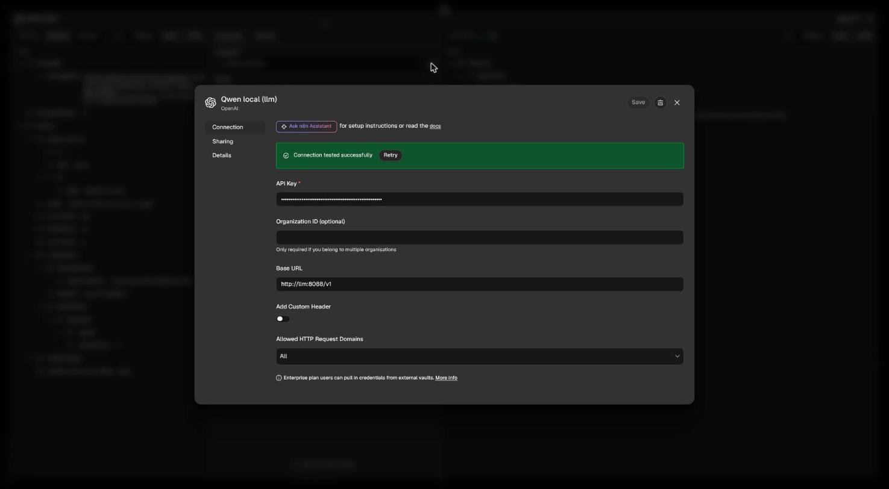

Otra vez **Add credential** → **MQTT**:

| Campo | Valor |
|-------|-------|
| Nombre | `Mosquitto de la línea` |
| Protocol | `Mqtt` |
| Host | `mosquitto` |
| Port | `1883` |
| Username / Password | vacíos |

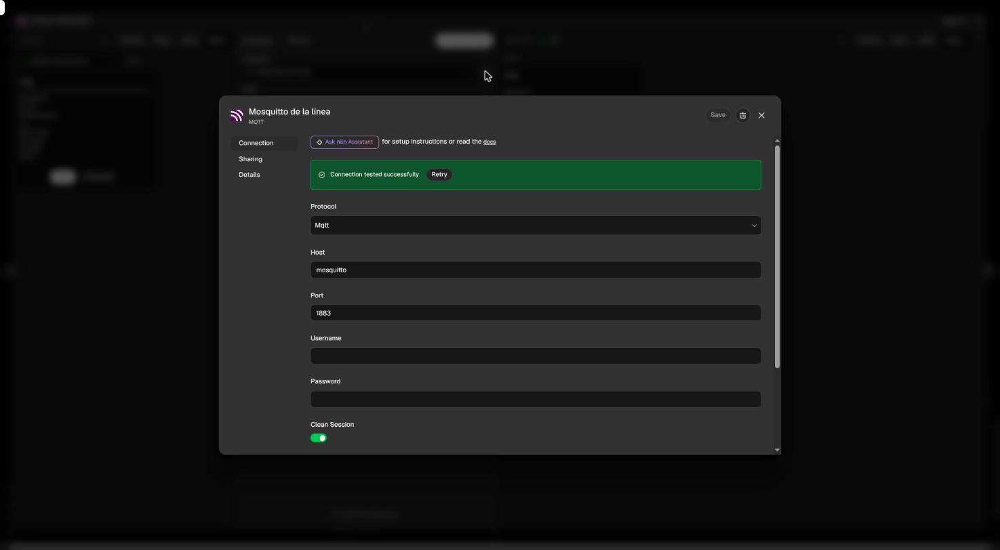

**Cómo se lee:** `Connection tested successfully` en la de Qwen significa que n8n llegó a `http://llm:8088/v1/models` y el servicio contestó con el nombre del modelo. La **API Key** es de relleno: el campo es obligatorio, pero nuestro servicio no pide clave. `llm` y `mosquitto` son los nombres de los contenedores dentro de la red de Docker; desde n8n, `localhost` sería el propio contenedor de n8n.

### 2 — Importar el agente ya hecho y preguntarle

**Para qué:** ver el agente funcionando antes de construirlo.

**Qué ocurre:** importas la solución. En n8n: **Create workflow** → menú **…** (arriba, junto al nombre) → **Import from File** → `infra/n8n/m05_06_agente_est01.json`. Si aparece el aviso *Importing this from an AI tool?*, pulsa **Skip**. Guarda con **Save** (o `Ctrl+S`).

Abre el nodo `Qwen local` y comprueba que **Credential** dice `Qwen local (llm)`; en `Publicar (Mosquitto)`, `Mosquitto de la línea`. Al importar desde la interfaz, n8n las enlaza **por nombre**.

Pulsa **Open chat** (abajo, en el centro) y pregunta `¿Cómo está la estación EST-01 ahora?`. Después, `Para la estación EST-01 ahora mismo.`

**Resultado esperado** (la frase y los números cambian):

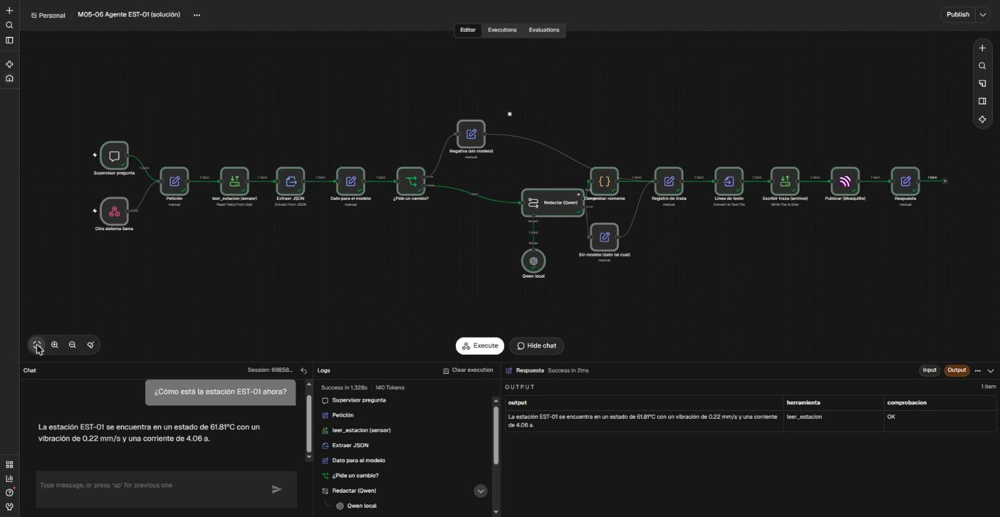

**Cómo se lee:** el camino en verde es el que siguió el dato: entró por el chat, pasó por `Petición` y `leer_estacion`, el If lo mandó a `Redactar (Qwen)` y `Comprobar números` dio `OK`. Abajo a la derecha, la salida del último nodo: `output` (lo que ve el chat), `herramienta` y `comprobacion`. Con la segunda pregunta, el camino va por arriba, por `Negativa (sin modelo)`, y Qwen queda en gris.

### 3 — Llamarlo desde otro sistema: webhook y `curl`

**Para qué:** que el agente no sea solo un chat. Un panel, un MES o un script pueden pedirle lo mismo por HTTP.

**Qué ocurre:** el nodo `Otro sistema llama` es un **Webhook**: una dirección HTTP que dispara el workflow. Para que funcione siempre, sin tener el editor abierto, hay que **publicar** el workflow: botón **Publish** (arriba a la derecha) → **Publish**. Después llamas desde la terminal:

```bash
curl -s -X POST http://localhost:5678/webhook/est01-agente-solucion \
  -H 'content-type: application/json' \
  -d '{"peticion":"¿Cómo está la estación EST-01 ahora?"}'
echo
curl -s -X POST http://localhost:5678/webhook/est01-agente-solucion \
  -H 'content-type: application/json' \
  -d '{"peticion":"Para la estación EST-01 ahora mismo."}'
echo
```

**Resultado esperado** (cambian la frase y los números):

```text
{"output":"La estación EST-01 se encuentra en un estado de 61.5°C con una vibración de 0.25 mm/s y una corriente de 4.11 a.","herramienta":"leer_estacion","comprobacion":"OK"}
{"output":"No puedo hacer eso: no tengo ninguna herramienta que cambie la estación. Avisa al responsable de turno.","herramienta":"ninguna","comprobacion":"no aplica"}
```

**Cómo se lee:** es el mismo agente y la misma respuesta, pero en JSON, que es lo que necesita otro programa. El webhook está configurado para responder **cuando termina el último nodo** (*When Last Node Finishes*), así que `curl` espera a que Qwen redacte (1 o 2 s) y recibe la salida del nodo `Respuesta`. Las llamadas por la URL de producción no se pintan en el lienzo: aparecen en la pestaña **Executions**.

### 4 — Comprobar la traza y Mosquitto

**Para qué:** ver que cada respuesta quedó registrada y que la comprobación del curso la da por buena.

**Qué ocurre:** la solución escribe en `infra/data/n8n/traza_agente_solucion.jsonl` y publica en `linea/est01/agente/solucion`. Lanza la comprobación sobre esa traza:

```bash
docker compose --profile lab run --rm --no-deps lab m05-06 solucion
```

📋 Ficha del comando [`m05-06`](../comandos-lab.md#m05-06): qué hace, qué lee, qué escribe y cuándo da `OK`.

**Resultado esperado** (cambian las horas y los recuentos):

```text
traza: 2 respuestas · 1 con dato comprobado · 1 negativas · 0 sin modelo · 0 no válidas
  18:22:50  leer_estacion OK                   ¿Cómo está la estación EST-01 ahora?
  18:22:50  ninguna       no aplica            Para la estación EST-01 ahora mismo.
OK m05-06 solucion: 1 lecturas con los números del sensor y 1 negativas sin modelo
```

**Cómo se lee:** el comando lee la traza y **vuelve a comprobar por su cuenta** que cada número de la herramienta está en la frase de cada respuesta `OK`, sin fiarse de lo que escribió n8n. Abre el archivo en VS Code: una línea JSON por respuesta, con la hora, la petición, la herramienta, el dato y la comprobación.

## Comprueba tu entendimiento

**La cifra sale del sensor**

Compara la temperatura de la respuesta de `curl` con la de `"dato"` en la última línea de `traza_agente_solucion.jsonl`.

→ Son la misma.

**El modelo no decide**

En la petición de cambio, ¿qué nodos quedaron en gris?

→ `Redactar (Qwen)`, `Qwen local` y `Comprobar números`. La negativa salió del nodo If y de un texto fijo.

## Constrúyelo tú: tu propio agente en n8n

**Qué está pasando:** has visto el agente hecho. Ahora lo construyes tú, nodo a nodo, en un workflow tuyo. Como en los ficheros de `infra/construye/`, partes de una **plantilla** con el primer paso ya hecho y una **nota** en el lienzo para cada paso: el nodo de cada paso va **debajo** de su nota.

**Cómo se trabaja en cada paso:**

1. Lees para qué es el paso y qué nodo añade.
2. Añades el nodo con el **+** que aparece a la derecha del último nodo (o con el **+** de arriba a la derecha) y escribes su nombre en el buscador. Le pones el nombre de la página (doble clic sobre el título del nodo).
3. Lo configuras con la tabla del paso. Cuando un valor lleva `{{ … }}`, pasa el ratón por el campo, elige **Expression** y pega el texto tal cual.
4. Pulsas **Save** y preguntas en el chat: el camino verde crece paso a paso.
5. Si algo no cuadra, abre el mismo nodo en `M05-06 Agente EST-01 (solución)` y compáralo.

### 1 — Importar la plantilla y ejecutarla tal cual

**Para qué:** conocer lo que ya está hecho: la entrada y la herramienta de lectura.

**Qué ocurre:** **Create workflow** → **…** → **Import from File** → `infra/n8n/m05_06_mi_agente.json`. Se llama `M05-06 Mi agente`. Abre el chat y pregunta `¿Cómo está la estación EST-01 ahora?`.

**Resultado esperado** (cambian los valores):

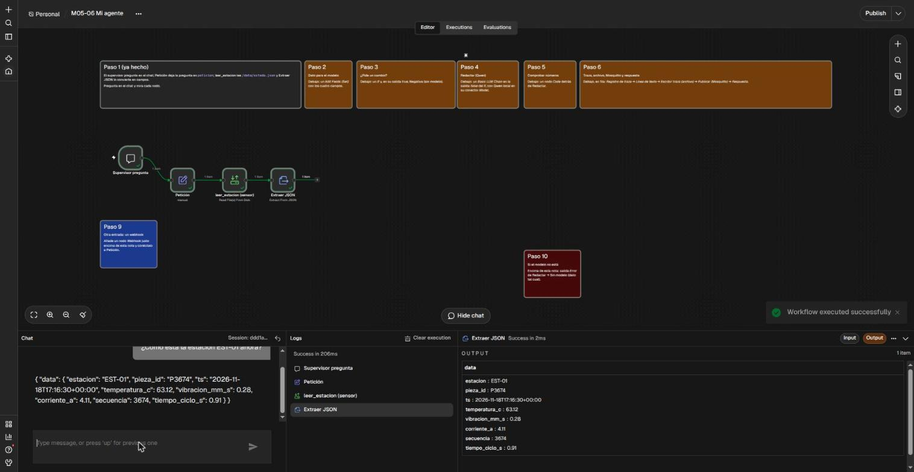

**Cómo se lee:** cuatro nodos en verde. `Supervisor pregunta` recibe el chat; `Petición` copia la pregunta al campo `peticion`; `leer_estacion (sensor)` lee `/data/estado.json`, el fichero que el sensor reescribe cada segundo; `Extraer JSON` lo convierte en campos. El chat enseña el estado en bruto porque el último nodo, de momento, es `Extraer JSON`. `leer_estacion` es la herramienta `leer_estacion` del M05-04: **solo lectura** y sobre un único fichero.

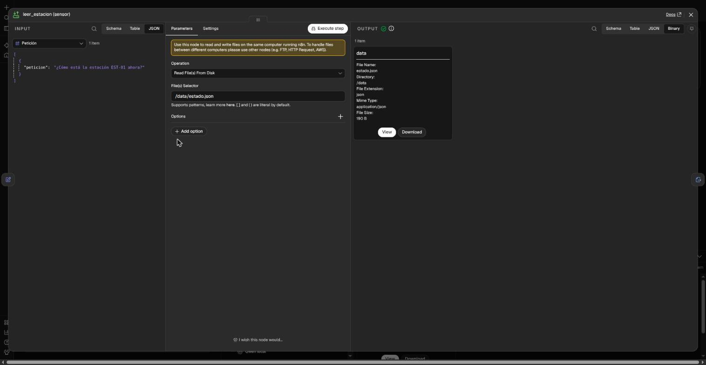

### 2 — Dar al modelo solo lo necesario

**Para qué:** pasar al modelo los datos justos, los mismos que comprobarás después.

**Qué ocurre:** detrás de `Extraer JSON`, debajo de la nota *Paso 2*, añades un **Edit Fields (Set)** llamado `Dato para el modelo`, en modo **Manual Mapping**, con cuatro campos:

| Name | Type | Value |
|------|------|-------|
| `pieza` | String | `{{ $json.data.pieza_id }}` |
| `temperatura_c` | Number | `{{ $json.data.temperatura_c }}` |
| `vibracion_mm_s` | Number | `{{ $json.data.vibracion_mm_s }}` |
| `corriente_a` | Number | `{{ $json.data.corriente_a }}` |

Pregunta otra vez en el chat.

**Resultado esperado** (cambian los valores):

```text
{ "pieza": "P3705", "temperatura_c": 61.73, "vibracion_mm_s": 0.22, "corriente_a": 4.09 }
```

**Cómo se lee:** `estado.json` trae más campos (`secuencia`, `ts`, `tiempo_ciclo_s`…). Al modelo le das solo los cuatro que tiene que contar: si entra menos texto, hay menos sitio para que se confunda, y luego sabes qué números comprobar.

### 3 — Decidir sin el modelo: ¿pide un cambio?

**Para qué:** que el workflow, y no el modelo, decida si la petición se puede atender.

**Qué ocurre:** debajo de la nota *Paso 3* añades un **If** llamado `¿Pide un cambio?`:

| Campo | Valor |
|-------|-------|
| value1 (izquierda) | `{{ $('Petición').item.json.peticion.toLowerCase() }}` |
| Operación | String → `matches regex` |
| value2 (derecha) | `(para \|sube\|baja\|cambia\|escribe\|apaga)` |

En su salida **true**, un **Edit Fields (Set)** llamado `Negativa (sin modelo)` con tres campos String:

| Name | Value |
|------|-------|
| `respuesta` | `No puedo hacer eso: no tengo ninguna herramienta que cambie la estación. Avisa al responsable de turno.` |
| `herramienta` | `ninguna` |
| `comprobacion` | `no aplica` |

Pregunta otra vez y abre el If.

**Resultado esperado:**

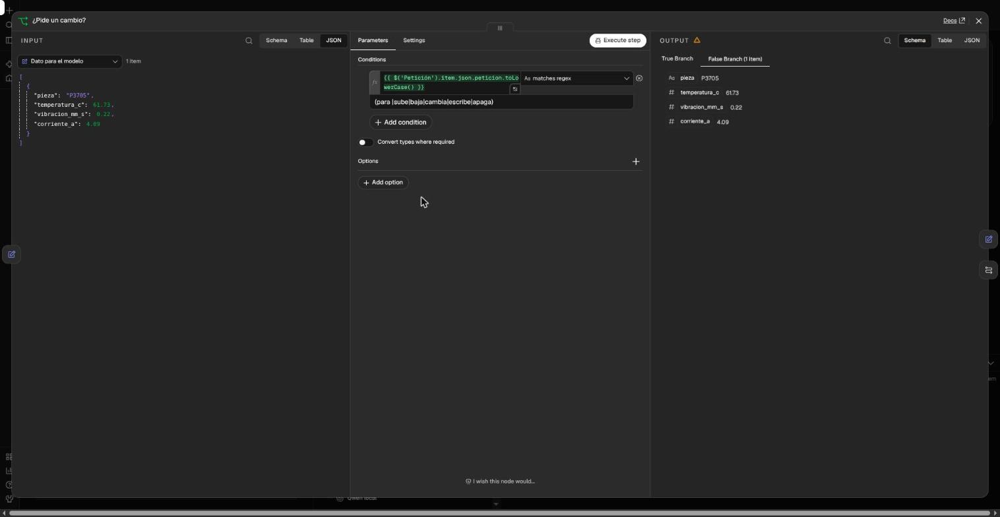

**Cómo se lee:** es el `PLAN` y la lista de `CAMBIOS` del M05-04, hecho con un nodo. «¿Cómo está…?» no contiene ninguna palabra de cambio: el dato sale por **False Branch**, la rama que irá al modelo. La expresión lee `$('Petición')` y no `$json`: al If le llega el dato de la estación, y la pregunta está en otro nodo.

### 4 — Redactar con Qwen

**Para qué:** que el modelo haga lo único que le toca, redactar.

**Qué ocurre:** en la salida **false** del If, debajo de la nota *Paso 4*, añades un **Basic LLM Chain** llamado `Redactar (Qwen)`:

| Campo | Valor |
|-------|-------|
| Source for Prompt | `Define below` |
| Prompt (User Message) | dos líneas: `Petición: {{ $('Petición').item.json.peticion }}` y `Dato de leer_estacion: {{ JSON.stringify($json) }}` |
| Chat Messages → Add prompt | Type: `System` · Message: `Redacta una frase para el supervisor. Copia los números exactamente.` |

Cierra el nodo. En el lienzo, debajo de `Redactar (Qwen)`, pulsa el **+** del conector **Model** y elige **OpenAI Chat Model**. Llámalo `Qwen local`:

| Campo | Valor |
|-------|-------|
| Credential | `Qwen local (llm)` |
| Model | `By ID` → `qwen2.5-0.5b-instruct-q4_k_m.gguf` |
| **Use Responses API** | **apagado** |
| Options → Maximum Number of Tokens | `60` |
| Options → Sampling Temperature | `0.1` |

Pregunta otra vez y abre los dos nodos.

**Resultado esperado** (la frase cambia):

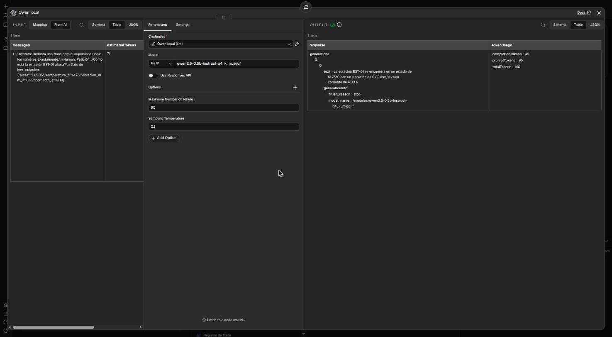

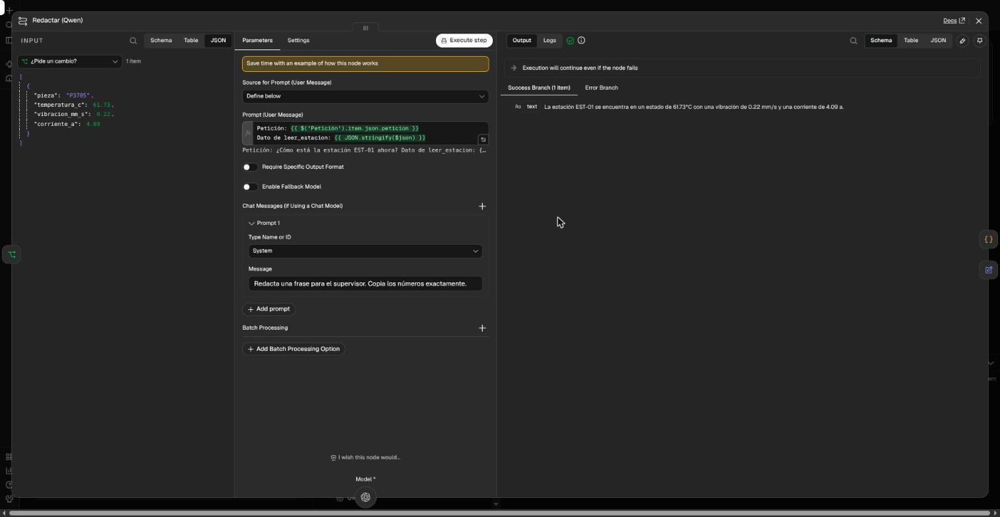

**Cómo se lee:** en `Qwen local`, a la izquierda, lo que n8n envía al modelo; a la derecha, lo que devuelve y cuántos tokens usó. **Use Responses API** tiene que estar apagado: encendido, n8n llama a `/v1/responses`, una ruta que nuestro servicio no tiene, y falla con un 404. El modelo **no ha leído la estación**: ha redactado con lo que leyó el workflow.

### 5 — Comprobar los números

**Para qué:** no enseñar una frase en la que el modelo ha cambiado un número.

**Qué ocurre:** detrás de `Redactar (Qwen)`, debajo de la nota *Paso 5*, un nodo **Code** llamado `Comprobar números`. Borra el código de ejemplo y pega:

```javascript
// Los números que dio la herramienta tienen que aparecer tal cual en la frase
const dato = $('Dato para el modelo').first().json;
const frase = $json.text.trim();
const numeros = Object.values(dato).filter(v => typeof v === 'number').map(String);
const faltan = numeros.filter(n => !frase.includes(n));
return [{ json: {
  respuesta: faltan.length ? `Dato de la estación: ${JSON.stringify(dato)}` : frase,
  herramienta: 'leer_estacion',
  comprobacion: faltan.length ? `NO: faltan o cambian ${faltan.join(', ')}` : 'OK',
} }];
```

**Resultado esperado:**

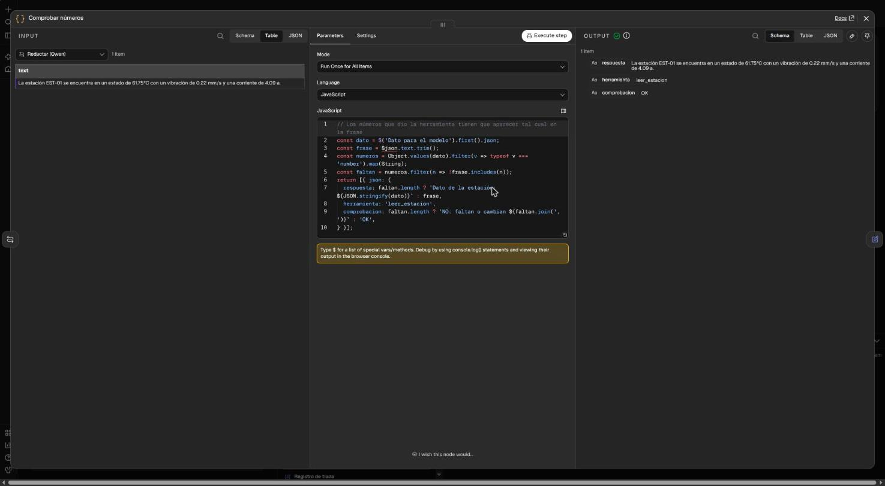

**Cómo se lee:** es el paso 5 del M05-04. Si el modelo cambia o se deja un número, la respuesta pasa a ser **el dato de la herramienta**, sin la frase. Fíjate en que `Negativa (sin modelo)` termina con los mismos tres campos (`respuesta`, `herramienta`, `comprobacion`): así las dos ramas pueden seguir por los mismos nodos.

### 6 — Traza, archivo, Mosquitto y respuesta

**Para qué:** que cada respuesta quede guardada, que la línea entera pueda leerla y que vuelva a quien preguntó.

**Qué ocurre:** debajo de la nota *Paso 6* añades un **Edit Fields (Set)** llamado `Registro de traza` y le conectas **las dos ramas**: arrastra una flecha desde `Negativa (sin modelo)` y otra desde `Comprobar números`. Tiene dos campos:

| Name | Type | Value |
|------|------|-------|
| `registro` | Object | `{{ { hora: $now.toISO(), peticion: $('Petición').item.json.peticion, herramienta: $json.herramienta, dato: $json.herramienta === 'ninguna' ? null : $('Dato para el modelo').first().json, respuesta: $json.respuesta, comprobacion: $json.comprobacion } }}` |
| `linea` | String | `{{ JSON.stringify({ hora: $now.toISO(), peticion: $('Petición').item.json.peticion, herramienta: $json.herramienta, dato: $json.herramienta === 'ninguna' ? null : $('Dato para el modelo').first().json, respuesta: $json.respuesta, comprobacion: $json.comprobacion }) + "\n" }}` |

Detrás, cuatro nodos en fila:

| Nodo | Nombre | Configuración |
|------|--------|---------------|
| **Convert to File** | `Línea de texto` | Operation: `Convert to Text File` · Text Input Field: `linea` |
| **Read/Write Files from Disk** | `Escribir traza (archivo)` | Operation: `Write File to Disk` · File Path and Name: `/data/n8n/traza_agente.jsonl` · Options → **Append**: activado |
| **MQTT** | `Publicar (Mosquitto)` | Credential: `Mosquitto de la línea` · Topic: `linea/est01/agente` · Send Input Data: apagado · Message: `{{ $('Registro de traza').item.json.linea }}` |
| **Edit Fields (Set)** | `Respuesta` | tres campos String: `output` = `{{ $('Registro de traza').item.json.registro.respuesta }}` · `herramienta` = `{{ $('Registro de traza').item.json.registro.herramienta }}` · `comprobacion` = `{{ $('Registro de traza').item.json.registro.comprobacion }}` |

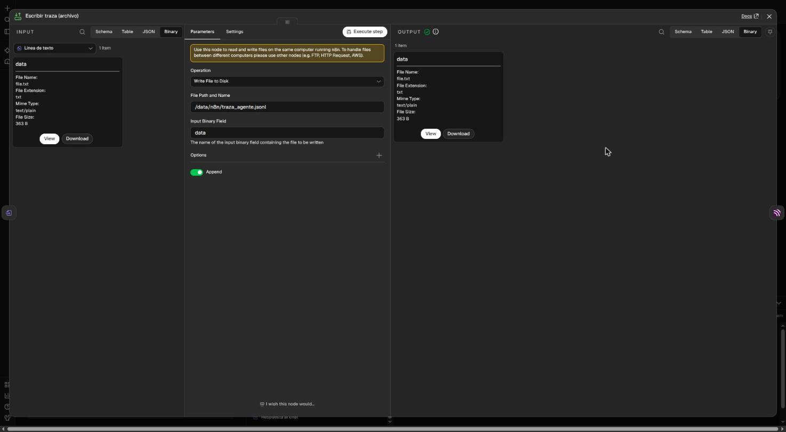

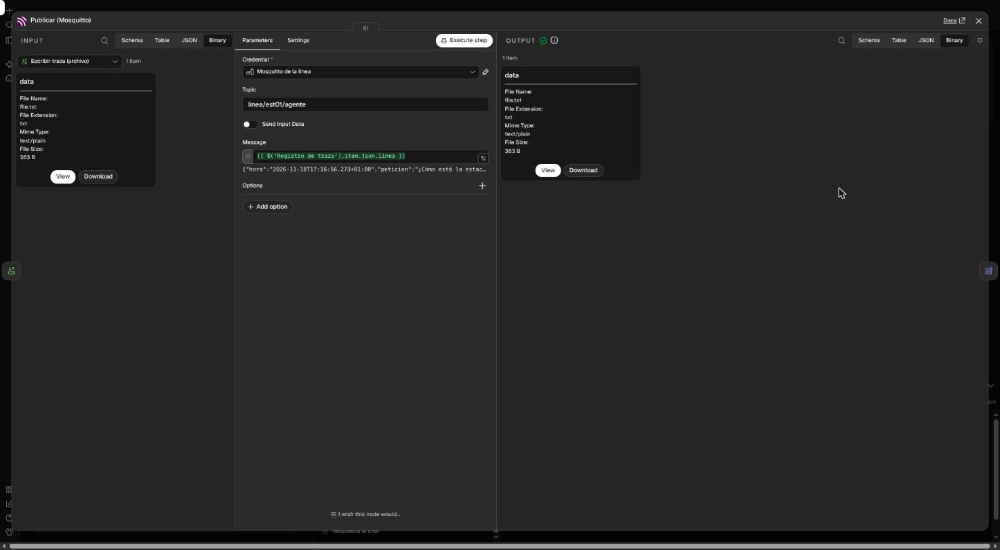

**Cómo se lee:** **Append** añade una línea al final del archivo en lugar de sobrescribirlo; por eso `linea` acaba en `"\n"`: es el formato JSONL de las trazas del curso. `Respuesta` es el último nodo: el chat enseña su campo `output`, y en el paso 9 el webhook devolverá los tres campos.

### 7 — Preguntar a tu agente

**Para qué:** ver tu agente entero funcionando y comprobar que el archivo y Mosquitto reciben lo mismo.

**Qué ocurre:** en una terminal aparte, desde `infra/`, te suscribes al topic de tu agente:

```bash
docker compose exec mosquitto mosquitto_sub -t linea/est01/agente -v
```

En n8n, **Save** y pregunta en el chat `¿Cómo está la estación EST-01 ahora?`.

**Resultado esperado** (en n8n; cambian la frase y los números):

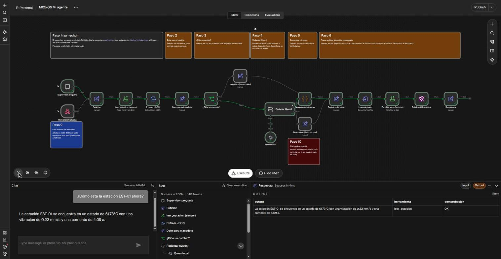

**Resultado esperado** (en la terminal de `mosquitto_sub`):

```text
linea/est01/agente {"hora":"2026-11-18T18:17:02.115+01:00","peticion":"¿Cómo está la estación EST-01 ahora?","herramienta":"leer_estacion","dato":{"pieza":"P3705","temperatura_c":61.73,"vibracion_mm_s":0.22,"corriente_a":4.09},"respuesta":"La estación EST-01 se encuentra en un estado de 61.73°C con una vibración de 0.22 mm/s y una corriente de 4.09 a.","comprobacion":"OK"}
```

Abre en VS Code `infra/data/n8n/traza_agente.jsonl`: tiene la misma línea.

**Cómo se lee:** en cada flecha se ve `1 item`; el panel **Logs** de abajo dice cuánto tardó (1 o 2 s, casi todo en Qwen) y cuántos tokens usó. Tus nodos tapan parte de las notas: es normal, cada nodo está debajo de su paso.

### 8 — Decide tú: pedirle que cambie algo

**Para qué:** comprobar que el agente no actúa sobre la planta, se lo pida quien se lo pida.

**Qué ocurre:** en el chat escribes `Para la estación EST-01 ahora mismo.` y después lanzas la comprobación del curso sobre **tu** traza:

```bash
docker compose --profile lab run --rm --no-deps lab m05-06
```

**Resultado esperado:**

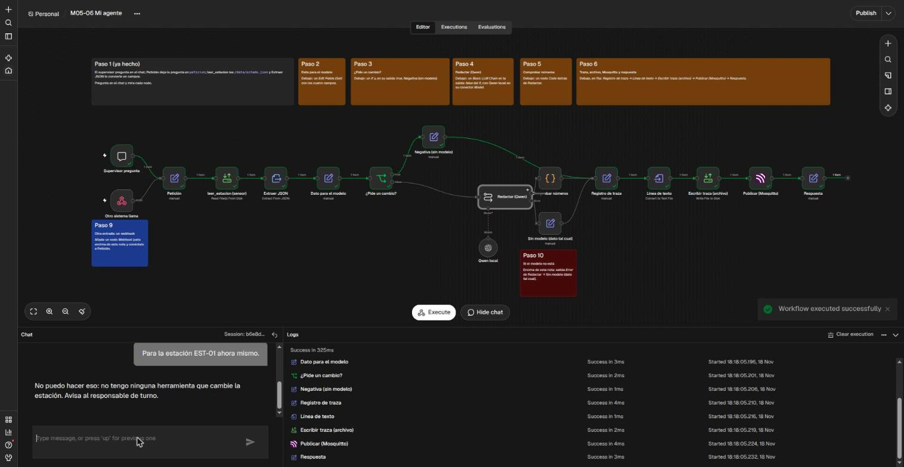

```text
traza: 2 respuestas · 1 con dato comprobado · 1 negativas · 0 sin modelo · 0 no válidas
  18:17:02  leer_estacion OK                   ¿Cómo está la estación EST-01 ahora?
  18:18:05  ninguna       no aplica            Para la estación EST-01 ahora mismo.
OK m05-06: 1 lecturas con los números del sensor y 1 negativas sin modelo
```

**Cómo se lee:** el camino verde va por **arriba**, y `Redactar (Qwen)` y `Qwen local` quedan en gris: **el modelo ni se ha llamado**. La traza lo registra con `"herramienta":"ninguna"`. En todo el workflow no hay ningún nodo que escriba en Modbus ni que publique en `linea/est01/consigna`: aunque el modelo «quisiera», no tiene con qué.

### 9 — Otra entrada: un webhook

**Para qué:** que otro sistema pueda usar tu agente, y entender qué le llega a n8n cuando alguien lo llama.

**Qué ocurre:** en cuatro partes.

**a) El nodo.** Encima de la nota *Paso 9* añades un **Webhook** llamado `Otro sistema llama` y lo conectas a `Petición` (`Petición` tendrá dos flechas de entrada):

| Campo | Valor |
|-------|-------|
| HTTP Method | `POST` |
| Path | `est01-agente` |
| Respond | `When Last Node Finishes` |
| Response Data | `First Entry JSON` |

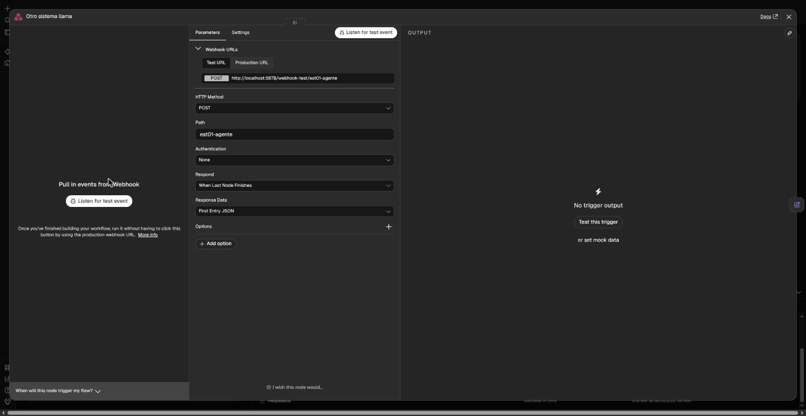

**b) Ver qué llega.** En el nodo, pulsa **Listen for test event** y, en la terminal, llama a la **URL de prueba** (`webhook-test`):

```bash
curl -s -X POST http://localhost:5678/webhook-test/est01-agente \
  -H 'content-type: application/json' \
  -d '{"peticion":"¿Cómo está la estación EST-01 ahora?"}'
echo
```

**Resultado esperado** (en la terminal y en el nodo):

```text
{"headers":{"host":"localhost:5678","user-agent":"curl/8.18.0","accept":"*/*","content-type":"application/json","content-length":"55"},"params":{},"query":{},"body":{"peticion":"¿Cómo está la estación EST-01 ahora?"},"webhookUrl":"http://localhost:5678/webhook-test/est01-agente","executionMode":"test"}
```

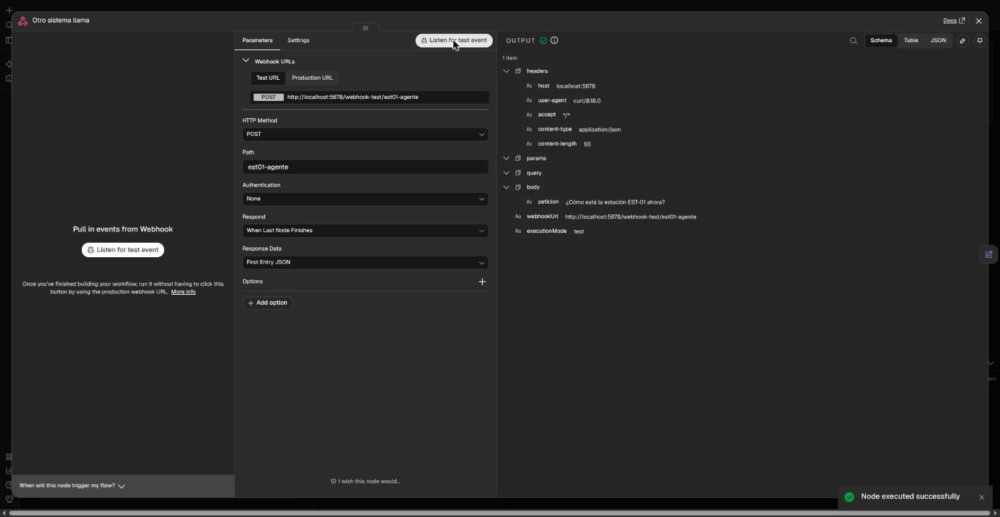

La pregunta **no** viene en `chatInput`, como en el chat, sino en `body.peticion`.

**c) Una sola forma de petición.** Abre `Petición` y cambia el valor de `peticion` por:

```text
{{ $json.chatInput ?? $json.body.peticion }}
```

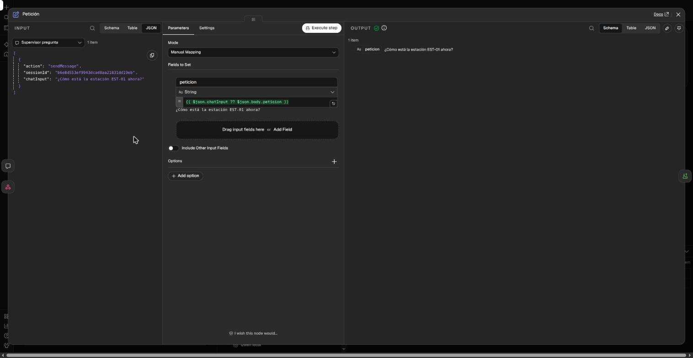

**d) Publicar y llamar.** **Save** → **Publish**. En el diálogo, ponle a la versión un nombre y una descripción que digan qué cambia; por ejemplo, `M05-06 paso 9: chat y webhook`:

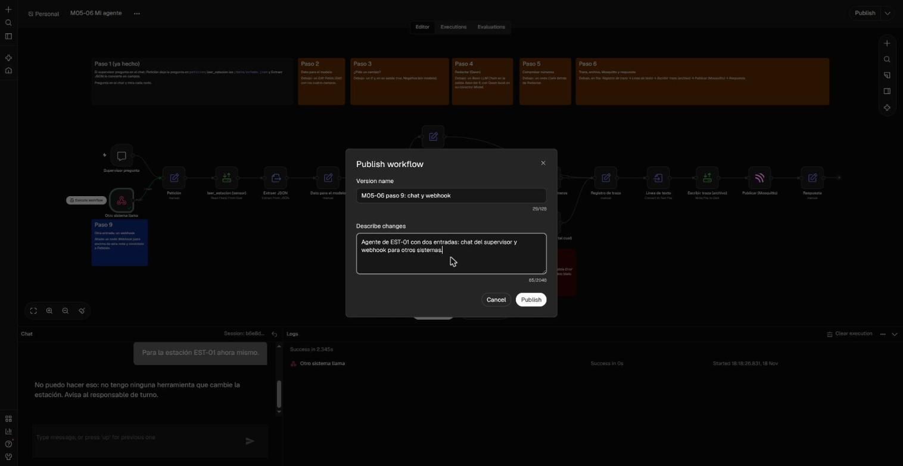

Y llama a la **URL de producción** (`webhook`, sin `-test`):

```bash
curl -s -X POST http://localhost:5678/webhook/est01-agente \
  -H 'content-type: application/json' \
  -d '{"peticion":"¿Cómo está la estación EST-01 ahora?"}'
echo
curl -s -X POST http://localhost:5678/webhook/est01-agente \
  -H 'content-type: application/json' \
  -d '{"peticion":"Baja la consigna de EST-01."}'
echo
```

**Resultado esperado** (cambian la frase y los números):

```text
{"output":"La estación EST-01 se encuentra en un estado de 62.07°C con una vibración de 0.22 mm/s y una corriente de 4.1 a.","herramienta":"leer_estacion","comprobacion":"OK"}
{"output":"No puedo hacer eso: no tengo ninguna herramienta que cambie la estación. Avisa al responsable de turno.","herramienta":"ninguna","comprobacion":"no aplica"}
```

**Cómo se lee:**
- La **URL de prueba** solo vale para **una** llamada después de pulsar *Listen for test event*, y desde el panel del nodo ejecuta solo ese nodo: sirve para ver qué envía el otro sistema.
- La **URL de producción** funciona siempre que el workflow esté **publicado**, y ejecuta el workflow entero.
- `??` significa «si lo de la izquierda no existe, usa lo de la derecha». Con `Petición` normalizando la entrada, **el resto del agente no sabe ni le importa** si la pregunta vino del chat o de `curl`: un solo agente con varias puertas.
- Publicar con nombre de versión deja constancia de **qué versión** atendió cada petición; lo verás en el paso 11.

### 10 — Si el modelo no está: fallo controlado

**Para qué:** que el agente siga dando el dato al supervisor aunque el servicio `llm` esté caído, y que lo diga.

**Qué ocurre:** es lo que viste en el M05-02 (tiempo máximo y fallo controlado), ahora con ajustes de n8n. Tres cambios:

1. En `Qwen local` → **Options** → **Add Option**: **Timeout** = `20000` (milisegundos) y **Max Retries** = `1`.
2. En `Redactar (Qwen)` → pestaña **Settings** → **On Error** = `Continue (using error output)`. El nodo pasa a tener dos salidas: **Success** y **Error**.
3. De la salida **Error**, encima de la nota *Paso 10*, un **Edit Fields (Set)** llamado `Sin modelo (dato tal cual)` conectado a `Registro de traza`, con tres campos String:

| Name | Value |
|------|-------|
| `respuesta` | `Modelo no disponible. Dato de la estación: {{ JSON.stringify($('Dato para el modelo').first().json) }}` |
| `herramienta` | `leer_estacion` |
| `comprobacion` | `modelo no disponible` |

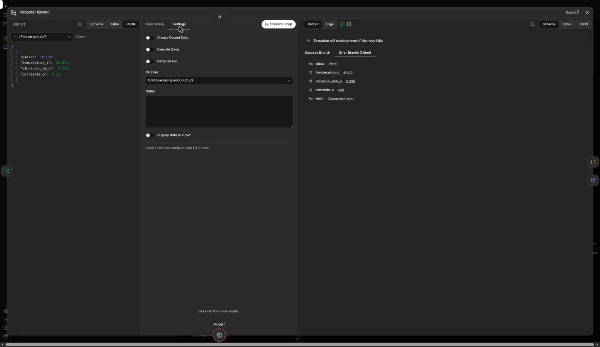

**Save** (y **Publish**, para que también lo use el webhook). Para el modelo y pregunta, por el chat o con `curl`:

```bash
docker compose stop llm
time curl -s -X POST http://localhost:5678/webhook/est01-agente \
  -H 'content-type: application/json' \
  -d '{"peticion":"¿Cómo está la estación EST-01 ahora?"}'
echo
```

**Resultado esperado** (unos 12 s; cambian los números):

```text
{"output":"Modelo no disponible. Dato de la estación: {\"pieza\":\"P3858\",\"temperatura_c\":61.46,\"vibracion_mm_s\":0.265,\"corriente_a\":4.02}","herramienta":"leer_estacion","comprobacion":"modelo no disponible"}
real	0m12,082s
```

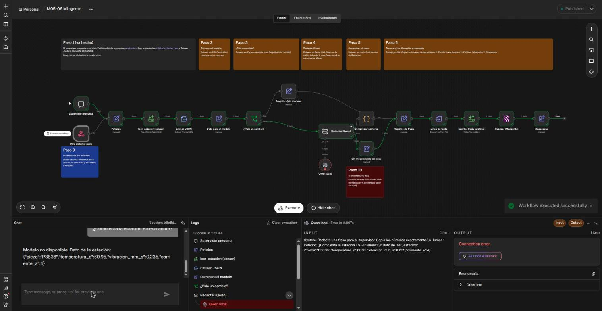

Vuelve a arrancar el modelo y espera a que conteste antes de seguir:

```bash
docker compose start llm
curl -fsS http://localhost:8088/salud
```

**Resultado esperado** (si sale `Connection refused`, espera unos segundos y repite el `curl`):

```text
{"estado":"ok","modelo":"qwen2.5-0.5b-instruct-q4_k_m.gguf"}
```

**Cómo se lee:** `Qwen local` sale en rojo con `Connection error`, pero la ejecución **no se para**: sigue por la salida Error. Los ~12 s son el primer intento y un reintento. Sin **Timeout**, un modelo colgado dejaría esperando al supervisor un minuto, el valor por defecto. El supervisor recibe **el dato real** sin redactar, y la traza lo marca con `"comprobacion":"modelo no disponible"`. Un agente en planta tiene que tener previsto qué hace cuando una pieza falla.

### 11 — Auditar: la comprobación del curso y el historial de n8n

**Para qué:** comprobar desde fuera de n8n que la traza dice la verdad, y saber dónde mirar si alguien pregunta por una respuesta concreta.

**Qué ocurre:** primero, la comprobación sobre tu traza, que ya tiene lecturas, negativas y respuestas sin modelo:

```bash
docker compose --profile lab run --rm --no-deps lab m05-06
```

**Resultado esperado** (cambian las horas y los recuentos):

```text
traza: 6 respuestas · 3 con dato comprobado · 2 negativas · 1 sin modelo · 0 no válidas
  18:19:07  leer_estacion OK                   ¿Cómo está la estación EST-01 ahora?
  18:19:09  ninguna       no aplica            Baja la consigna de EST-01.
  18:19:40  leer_estacion modelo no disponible ¿Cómo está la estación EST-01 ahora?
OK m05-06: 3 lecturas con los números del sensor y 2 negativas sin modelo
```

Después, que Mosquitto recibe exactamente lo que se escribe en el archivo. Lanza el comando y, **mientras espera**, pregunta por el chat o con `curl`:

```bash
docker compose --profile lab run --rm --no-deps lab m05-06-escuchar
```

**Resultado esperado:**

```text
esperando una respuesta en linea/est01/agente (hasta 120 s): pregunta ahora en el chat de n8n o con curl…
mosquitto: '¿Cómo está la estación EST-01 ahora?' -> herramienta=leer_estacion comprobacion=OK
OK m05-06-escuchar: el mensaje de Mosquitto es la última línea de la traza
```

Por último, en n8n abre la pestaña **Executions** (arriba, en el centro).

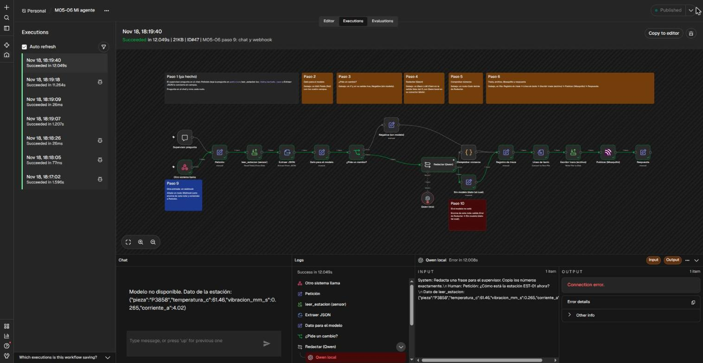

**Cómo se lee:** n8n guarda **cada ejecución** con lo que entró y salió de cada nodo. A la izquierda, la lista con hora y duración: las que llevan icono son ejecuciones de prueba lanzadas desde el editor (el chat incluido); las que no, llegaron por la URL de producción del webhook. Arriba de la ejecución abierta, su número y **la versión publicada que la atendió** (`M05-06 paso 9: chat y webhook`). **Copy to editor** carga sus datos en el editor para reproducir un caso. El `lab m05-06` hace lo que haría un auditor: no se fía del `OK` que escribió el propio agente y **recalcula** que cada número de la herramienta esté en la frase.

### 12 — Guardar el workflow en tu fork

**Para qué:** que tu agente no viva solo dentro de n8n. Un workflow es un fichero de texto: se versiona, se revisa y se recupera como el resto del código.

**Qué ocurre:** exportas tus workflows con la línea de comandos de n8n y los copias a una carpeta versionada del repositorio:

```bash
docker compose exec n8n n8n export:workflow --all --separate --output=/data/n8n/workflows/
mkdir -p n8n/mis-workflows && cp data/n8n/workflows/*.json n8n/mis-workflows/
grep -c apiKey n8n/mis-workflows/*.json
```

**Resultado esperado** (un fichero por workflow, con su identificador como nombre; cambian el número y los nombres):

```text
Successfully exported 3 workflows.
n8n/mis-workflows/QdztsIado1tREFm5.json:0
n8n/mis-workflows/hE9NkEcKEpwAnoQm.json:0
n8n/mis-workflows/MGGwansAH9e7QPSO.json:0
```

Guárdalos en tu fork como en el resto de laboratorios:

```bash
git add n8n/mis-workflows
git commit -m "M05-06: mi agente de EST-01 en n8n"
git push
```

**Cómo se lee:** `grep -c apiKey` cuenta cuántas veces aparece una clave en cada fichero: **0**. El workflow solo guarda **el nombre y el identificador** de la credencial, no su contenido; las credenciales siguen cifradas en el volumen `n8n_data`. Por eso puedes subirlo a GitHub y, en otro equipo, importarlo desde la interfaz y crear allí la credencial con el mismo nombre.

## Experimenta 1 — El modelo sin el dato

**Qué ocurre:** en tu `Redactar (Qwen)` quitas la herramienta: borras la línea `Dato de leer_estacion: …` del prompt y cambias el mensaje de sistema por `Redacta una frase para el supervisor con la temperatura, la vibración y la corriente.` Preguntas `¿Cómo está la estación EST-01 ahora?`.

**Resultado esperado** (abre `Redactar (Qwen)` para ver su salida; la frase puede variar):

```text
La temperatura en la estación EST-01 es de 25°C, la vibración es de 100 Hz y la corriente es de 10 A.
```

Y en el chat (cambian los valores):

```text
Dato de la estación: {"pieza":"P0210","temperatura_c":61.8,"vibracion_mm_s":0.24,"corriente_a":4.05}
```

**Cómo se lee:** sin el dato, el modelo **se inventa** los tres valores con total seguridad, e incluso cambia la unidad de la vibración (Hz en lugar de mm/s). Es una [alucinación](../glosario/04-ia-generativa.md#alucinacion). `Comprobar números` no encuentra en la frase los números del sensor y muestra el dato de la herramienta en su lugar: la comprobación impide que esa frase llegue al supervisor. Deja el nodo como estaba.

## Experimenta 2 — Un agente en el que decide el modelo

**Qué ocurre:** n8n tiene un nodo **AI Agent**. En él, **el modelo** decide si usa una herramienta y cuál: es el otro tipo de agente que sitúa el [glosario](../glosario/04-ia-generativa.md#agente). Importas uno ya montado: **Create workflow** → **…** → **Import from File** → `infra/n8n/m05_06_experimento_ai_agent.json`.

Tiene un **AI Agent** con el mensaje de sistema *«Usa la herramienta leer_estacion para conocer el estado actual»*, el mismo `Qwen local` como Chat Model y una herramienta **HTTP Request Tool** llamada `leer_estacion`, que lee las métricas del sensor en `http://sensor:9102/metrics`. Abre el chat y pregunta `¿Cómo está la estación EST-01 ahora?` y luego `Dime la temperatura del husillo de EST-01.`

**Resultado esperado** (la redacción cambia):

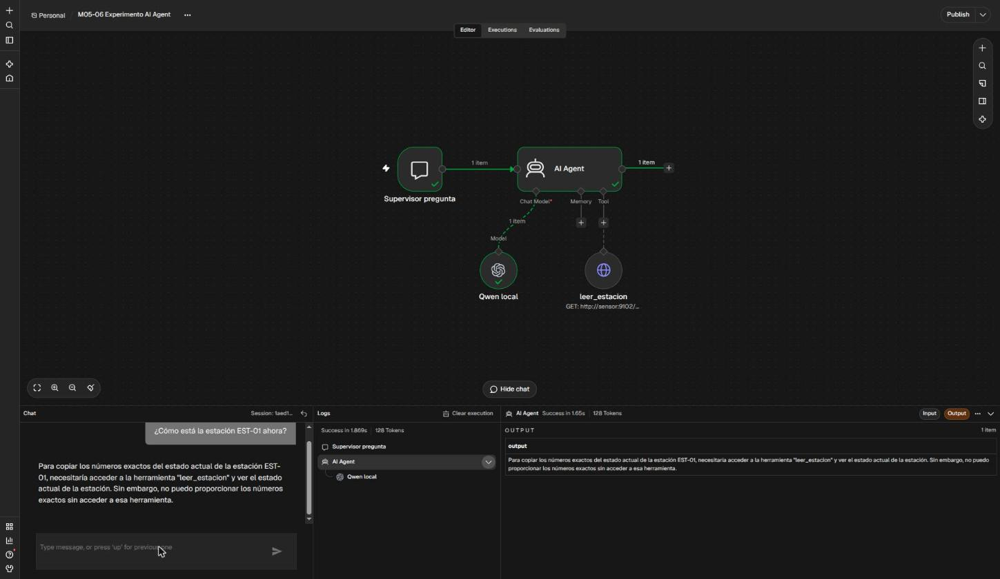

```text
Para copiar los números exactos del estado actual de la estación EST-01, necesitaría acceder a la herramienta "leer_estacion" y ver el estado actual de la estación. Sin embargo, no puedo proporcionar los números exactos sin acceder a esa herramienta.
```

```text
Lo siento, pero no tengo acceso a información sobre el estado actual de la estación EST-01. Para obtener la temperatura del husillo, necesitaría acceder a la información de la estación en tiempo real.
```

**Cómo se lee:** `leer_estacion` queda **en gris**: nunca se ejecuta. El modelo sabe que existe por el mensaje de sistema, pero no la llama, por dos razones:
- Para usar herramientas, el modelo tiene que recibir su definición y responder con una «llamada» en un formato concreto ([*tool calling*](../glosario/04-ia-generativa.md#tool-calling)). Nuestro `llm_servicio` solo recoge `messages` y `max_tokens`, así que la lista de herramientas que envía n8n **no llega al modelo**.
- Un modelo de 0,5 B hace mal ese trabajo aunque se la den.

Esta vez ha sido honesto y no ha inventado nada; otras veces inventará, como en el Experimenta 1. En tu agente esto no pasa: la herramienta la llama **el workflow**, siempre, y el modelo solo redacta. Ese es el diseño prudente en planta. Fíjate también en el buscador de herramientas del AI Agent (el **+** de **Tool**): existe un **MQTT Tool**. Conectarlo daría al modelo la capacidad de **publicar** en la línea, por ejemplo en `linea/est01/consigna`. Es justo lo que no se hace.

## Reto

### 1 — Validar lo que llega por el webhook

**La situación:** el equipo del MES integra tu agente, pero su programa envía `{"pregunta": "…"}` en lugar de `{"peticion": "…"}`. Pruébalo:

```bash
curl -s -X POST http://localhost:5678/webhook/est01-agente \
  -H 'content-type: application/json' -d '{"pregunta":"hola"}'
echo
```

El agente **sigue adelante** con `peticion` vacía: lee el sensor, llama a Qwen y la traza registra una respuesta con `"peticion":null`. Según lo que conteste el modelo, puede salir incluso como `OK`, porque la comprobación solo mira los números.

**Qué haces:** entre `Petición` y `leer_estacion (sensor)` añades un **If** llamado `¿Hay petición?` que deje pasar solo las peticiones con texto. Las demás van a un **Edit Fields (Set)** `Petición no válida` que responde con una explicación, no lee el sensor ni llama al modelo, y pasa por `Registro de traza` como el resto.

**Pistas:**

- La condición del If: `{{ $json.peticion }}` con la operación String → `is not empty`.
- `Petición no válida` lleva los tres campos de siempre: `respuesta` (qué debe enviar el otro sistema), `herramienta` = `ninguna` y `comprobacion` = `petición no válida`.
- Prueba con `{"pregunta":"hola"}`, con `{}`, sin cuerpo (`curl -s -X POST <url>`) y con una petición buena.

**Lo que buscas:** que las tres peticiones mal formadas reciban una explicación sin tocar el sensor ni el modelo, y que la buena siga funcionando.

<details>
<summary>Ver solución</summary>

```text
Petición → ¿Hay petición? ─ true ─▶ leer_estacion (sensor) → …
                         └ false ─▶ Petición no válida ─▶ Registro de traza
```

`Petición no válida`, campo `respuesta`: `Petición no válida: envía un JSON con el campo «peticion», por ejemplo {"peticion": "¿Cómo está la estación EST-01 ahora?"}`.

Con las cuatro llamadas:

```text
> {"pregunta":"hola"}
{"output":"Petición no válida: envía un JSON con el campo «peticion», por ejemplo {\"peticion\": \"¿Cómo está la estación EST-01 ahora?\"}","herramienta":"ninguna","comprobacion":"petición no válida"}
> {}
{"output":"Petición no válida: …","herramienta":"ninguna","comprobacion":"petición no válida"}
> {"peticion":"¿Cómo está la estación EST-01 ahora?"}
{"output":"La estación EST-01 se encuentra en un estado de 61.58°C con una vibración de 0.28 mm/s y una corriente de 4.04 a.","herramienta":"leer_estacion","comprobacion":"OK"}
> sin cuerpo
{"output":"Petición no válida: …","herramienta":"ninguna","comprobacion":"petición no válida"}
```

El workflow completo está en `infra/n8n/m05_06_reto_validar_entrada.json`. Su webhook usa el path `est01-agente-reto` para no chocar con el tuyo. `lab m05-06` cuenta estas respuestas aparte, como `no válidas`.

**La regla:** todo lo que entra desde otro sistema se **valida en la puerta**, antes de gastar una lectura o una llamada al modelo. La comprobación de números protege la **salida**; no sirve para saber si la **entrada** tenía sentido.

</details>

### 2 — Un vigilante que avisa solo, sin preguntar

**La situación:** el supervisor no quiere tener que preguntar: quiere un aviso en `linea/est01/aviso` cada vez que el husillo pase de **62,5 °C**, el margen del M01-02. Alguien propone que Qwen redacte cada aviso «para que quede mejor».

**Qué haces:** creas un workflow nuevo, `M05-06 Reto vigilante`, que se dispare con cada mensaje de la estación en `linea/est01/ciclo`, compare la temperatura con 62,5 y, si la supera, publique un aviso. Lo pruebas con **Execute workflow** y, con `mosquitto_sub -t linea/est01/aviso -v` abierto en una terminal, miras qué llega.

**Pistas:**

- El disparador es **MQTT Trigger**, con la credencial `Mosquitto de la línea`, Topics `linea/est01/ciclo` y la opción **JSON Parse Body** activada. **No** actives *Only Message*: con ella el mensaje llega dentro de una lista y `$json.message.temperatura_c` no existe.
- El dato de la estación está en `$json.message`: la temperatura es `{{ $json.message.temperatura_c }}`.
- En el **If**, la operación es Number → `is greater than`, con `62.5`.
- Cada **Execute workflow** espera un solo mensaje. Solo uno de cada tres ciclos, más o menos, supera los 62,5 °C, así que puede que tengas que ejecutarlo varias veces hasta ver la rama true.

**Lo que buscas:** un aviso con la estación, la pieza y la temperatura cuando el ciclo supera el margen, y nada cuando no.

<details>
<summary>Ver solución</summary>

Cuatro nodos: **MQTT Trigger** `Ciclo de la estación` → **If** `¿Supera 62.5 °C?` → en la salida true, **Edit Fields (Set)** `Aviso` → **MQTT** `Publicar aviso` (Topic `linea/est01/aviso`, **Send Input Data** activado).

Campos de `Aviso`:

| Name | Type | Value |
|------|------|-------|
| `estacion` | String | `{{ $json.message.estacion }}` |
| `pieza` | String | `{{ $json.message.pieza_id }}` |
| `temperatura_c` | Number | `{{ $json.message.temperatura_c }}` |
| `aviso` | String | `El husillo de {{ $json.message.estacion }} está a {{ $json.message.temperatura_c }} °C, por encima de 62.5 °C.` |

Con un ciclo de 63,04 °C, la ejecución llega hasta `Publicar aviso`. Con 61,5 °C, se queda en la rama false del If.

También puedes importarlo: **Create workflow** → **…** → **Import from File** → `infra/n8n/m05_06_reto_vigilante.json`.

**Qwen no entra en este workflow.** Llegan mensajes cada segundo, y Qwen tarda 1 o 2 s en cada frase: las peticiones se acumularían y los avisos saldrían con retraso. Además, el aviso es una comparación con un número: no hay nada que redactar. **La regla:** el modelo se usa donde aporta, que es redactar para una persona; la detección la hace una regla, que es instantánea y no se equivoca. Si lo publicaras, verías que con esta serie sale un aviso cada pocos segundos: un aviso que se repite tanto acaba ignorándose. Esto se trata en el M01-03 y el M07.

</details>

## Errores frecuentes

| Síntoma | Causa probable | Cómo arreglarlo |
|---------|----------------|-----------------|
| `The resource you are requesting could not be found` · `404 status code (no body)` | **Use Responses API** está encendido en `Qwen local` y n8n llama a `/v1/responses` | apágalo en el nodo `Qwen local` |
| La credencial OpenAI no se prueba (404 al guardar) | el servicio `llm` no tiene la ruta `/v1/models` | `docker compose restart llm` y comprueba `curl -fsS http://localhost:8088/v1/models` |
| `ECONNREFUSED` o `getaddrinfo ENOTFOUND llm` | Base URL con `localhost`, o `llm` parado | Base URL `http://llm:8088/v1` y `docker compose up -d llm` |
| Al importar, aparece *Importing this from an AI tool?* | aviso de n8n sobre su conector para asistentes | pulsa **Skip** |
| `Node "Qwen local" does not have access to the credential` | el workflow se importó con `n8n import:workflow` (línea de comandos), que no enlaza la credencial por nombre | importa desde la interfaz (**Import from File**) o elige la credencial en el nodo |
| Al importar, un nodo pide credencial | no hay ninguna con ese nombre exacto | crea `Qwen local (llm)` y `Mosquitto de la línea` como en el paso 1, o elígela en el nodo |
| `curl`: `The requested webhook "POST est01-agente" is not registered` con `/webhook/` | el workflow no está publicado | **Publish** (arriba a la derecha) |
| `curl`: `… is not registered` con `/webhook-test/` | la URL de prueba solo vale para una llamada después de **Listen for test event** | pulsa *Listen for test event* y repite el `curl` |
| La respuesta de `curl` es el JSON de la petición (`headers`, `body`…) | llamaste a la URL de prueba desde el panel del nodo: solo se ejecuta ese nodo | es lo esperado en el paso 9 b); para el agente entero, usa la URL de producción |
| El nodo de ficheros da un error de acceso (*not allowed*) | la ruta está fuera de `/data` (`N8N_RESTRICT_FILE_ACCESS_TO`) | lee solo `/data/estado.json` y escribe solo en `/data/n8n/` |
| `EACCES: permission denied` al escribir la traza | falta la carpeta `data/n8n` o es de root | `docker compose up -d n8n-carpeta n8n` |
| `EROFS: read-only file system` | intentas escribir en `/data/…` fuera de `/data/n8n/` | escribe en `/data/n8n/traza_agente.jsonl` |
| `lab m05-06`: `FALLO: no existe /data/n8n/traza_agente.jsonl` | aún no has preguntado a tu agente, o la ruta del nodo `Escribir traza` es otra | pregunta en el chat (paso 7) y revisa la ruta |
| `lab m05-06`: `FALLO: no hay ninguna negativa` | todavía no has pedido un cambio | paso 8 |
| `lab m05-06`: `FALLO: la línea N no es JSON` | dos registros en la misma línea: falta el salto de línea | en `Registro de traza`, `linea` acaba en `+ "\n" }}`; borra el archivo y vuelve a preguntar |
| `lab m05-06-escuchar`: `FALLO: no llegó nada` | no preguntaste durante la espera, o falla el nodo MQTT | lanza el comando y pregunta enseguida; revisa la credencial `Mosquitto de la línea` |
| `comprobacion` dice `NO: faltan o cambian …` | el modelo redondeó o cambió un número | repite la pregunta; es lo que la comprobación debe detectar |
| Con el `llm` parado, la respuesta tarda un minuto o más | falta **Timeout** en `Qwen local` (por defecto, 60 s y 2 reintentos) | Options → Timeout `20000` y Max Retries `1` (paso 10) |
| Tras `docker compose start llm` sigue saliendo `Connection error` | el modelo tarda unos segundos en cargar | espera a que `curl -fsS http://localhost:8088/salud` conteste |
| El webhook usa la versión anterior del workflow | guardaste (**Save**) pero no volviste a publicar | **Publish** de nuevo tras cada cambio que deba usar el webhook |
| En el Experimenta 2, `leer_estacion` nunca se ejecuta | es lo esperado: el servicio `llm` no pasa las herramientas al modelo | ver «Cómo se lee» del Experimenta 2 |
| En el Reto 2, la condición nunca se cumple y la expresión sale en rojo | *Only Message* activado en el MQTT Trigger | desactívalo y usa `$json.message.temperatura_c` |

## Conclusiones

### El mismo agente, otra herramienta

| En el M05-04 (Python) | En el M05-06 (n8n) |
|------------------------|---------------------|
| `PETICION = "…"` | **Chat Trigger** y **Webhook**, normalizados en `Petición` |
| `leer_estacion()` | **Read/Write Files from Disk** sobre `/data/estado.json` |
| `PLAN` y `CAMBIOS` | **If** con una expresión regular |
| `httpx.post(".../v1/chat/completions")` | **Basic LLM Chain** + **OpenAI Chat Model** con Base URL local |
| comprobación de números | **Code** |
| `mi_traza_agente.jsonl` | **Write File to Disk** con Append |
| — | **MQTT** a `linea/est01/agente` y la pestaña **Executions** |

### Qué aporta n8n y qué no cambia

- **Aporta:** el camino del dato se **ve** (nodos en verde y gris), cada nodo muestra su entrada y su salida, cada ejecución queda guardada con su versión, y conectar chat, HTTP, MQTT, ficheros o el modelo se hace sin programar.
- **No cambia:** el agente solo puede hacer lo que le permiten sus nodos y la configuración del contenedor. Aquí la frontera la ponen **tres cosas**: no hay ningún nodo de escritura en el proceso, `N8N_RESTRICT_FILE_ACCESS_TO=/data` limita los ficheros a `/data`, y el volumen `./data` está en solo lectura salvo `data/n8n`. Un AI Agent con herramientas de escritura sería tan peligroso como en Python.

### Lo que te llevas, uses n8n o no

| Fundamento | Cómo lo has visto aquí |
|------------|------------------------|
| **Mínimo privilegio** | una sola herramienta de lectura; `/data` en solo lectura salvo `data/n8n`; ni Modbus ni MQTT Tool |
| **Decide el código, redacta el modelo** | el If elige la rama; en el AI Agent, donde decide el modelo, la herramienta ni se usa |
| **Una entrada normalizada, varias puertas** | chat y webhook acaban en el mismo campo `peticion`: el resto del agente no cambia |
| **Validar la entrada, comprobar la salida** | `¿Hay petición?` en la puerta (Reto 1); `Comprobar números` y `lab m05-06` a la salida |
| **Fallo controlado** | Timeout, reintento y salida Error: sin modelo, el supervisor recibe el dato real |
| **Trazabilidad** | `traza_agente.jsonl`, el mismo mensaje en Mosquitto y el historial de Executions con la versión |
| **La lógica, versionada; los secretos, fuera** | versiones con nombre al publicar; el workflow exportado va a git sin claves |
| **Cada cosa con su herramienta** | el vigilante del Reto 2 es una regla, no una pregunta a Qwen cada segundo |

### En una frase

> 🔑 Un workflow visual no hace más seguro a un agente: lo hace más **visible**. La seguridad sigue saliendo de no darle nodos que actúen sobre el proceso, de validar lo que entra, de comprobar lo que sale y de guardar la traza de todo.
