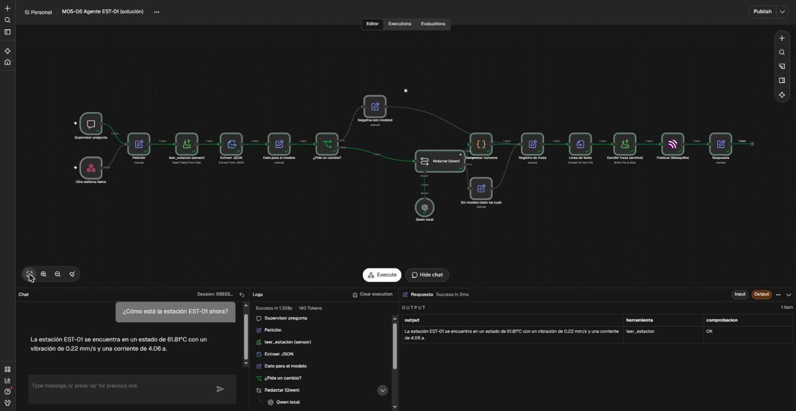

# M05 — Inteligencia artificial generativa

[← Página anterior](../M04-vision-control-calidad/M04-04-red-neuronal.md) · [Siguiente página →](M05-01-modelo-local.md)

> [!NOTE]
> **Cómo funciona este módulo.** Tiene seis bloques, uno por laboratorio. En cada bloque: primero la **teoría** y una **demostración** que se proyecta en clase, paso a paso; después **practicas tú** con el laboratorio, a tu ritmo.

## Qué aprenderás

- Qué es un **[modelo de lenguaje](../glosario/04-ia-generativa.md#llm)** y qué supone ejecutarlo **en el propio puesto**.
- Cómo se **integra** en una aplicación y cómo debe comportarse esa aplicación cuando el modelo falla.
- Por qué un modelo **[se inventa](../glosario/04-ia-generativa.md#alucinacion)** respuestas y cómo se le hace responder desde los **documentos** de la planta.
- Qué es un **[agente](../glosario/04-ia-generativa.md#agente)** y cómo se limita lo que puede hacer.
- Qué **[modelos abiertos](../glosario/06-modelos-abiertos.md#mapa)** existen para cada tarea, cómo se eligen para un equipo de la planta y qué [licencia](../glosario/06-modelos-abiertos.md#licencias) hay que mirar.

| Bloque | Concepto | Laboratorio |
|--------|----------|-------------|
| 1 | Un modelo de lenguaje en local | [M05-01](M05-01-modelo-local.md) |
| 2 | Integración en aplicaciones | [M05-02](M05-02-integracion-aplicacion.md) |
| 3 | Asistente basado en documentación | [M05-03](M05-03-asistente-documentacion.md) |
| 4 | Agentes con herramientas | [M05-04](M05-04-agentes.md) |
| 5 | Elegir y servir un modelo abierto | [M05-05](M05-05-modelos-abiertos.md) |
| 6 | El agente en un workflow visual (n8n) | [M05-06](M05-06-agentes-n8n.md) |

## Antes de empezar

El modelo es un fichero de unos [470 MB](../glosario/04-ia-generativa.md#cuantizacion) en `infra/modelos/`. Lo deja la prueba del puesto. El contenedor que lo ejecuta necesita hasta 2 GB de memoria: si tienes el panel o [Prometheus](../glosario/02-observabilidad.md#prometheus) en marcha y vas justo de memoria, páralos.

```bash
cd infra
ls -lh modelos/
docker compose stop panel
docker compose up -d llm
```

## Introducción: un modelo que escribe

Un **modelo de lenguaje** (como los que hay detrás de los asistentes de chat) es una red neuronal muy grande entrenada para **continuar texto**: dado un texto, predice qué palabra va después, una y otra vez. De ahí sale su capacidad de contestar, resumir o redactar.

Dos consecuencias que guían todo el módulo:

| Propiedad | Consecuencia en planta |
|-----------|------------------------|
| Escribe lo que **suena bien**, no lo que es verdad | Si no sabe algo, puede inventarlo con total seguridad |
| No sabe nada de **tu** planta | Lo que tenga que saber de EST-01 se lo tienes que dar tú |

En este curso el modelo es **Qwen2.5 de 0,5B** (500 millones de pesos), comprimido a 4 bits y ejecutado en la CPU del puesto. Es pequeño a propósito: cabe en un portátil y **ningún dato sale de la fábrica**.

---

## Bloque 1 — Un modelo de lenguaje en local

### Teoría

Un modelo local son dos cosas: un **fichero** con los pesos y un **proceso** que lo carga en memoria y atiende peticiones. Ejecutarlo en el puesto tiene ventajas y precio:

| | Modelo local pequeño | Servicio externo grande |
|--|----------------------|-------------------------|
| Datos | No salen del puesto | Salen de la fábrica |
| Disponibilidad | No depende de internet | Depende de la conexión y del proveedor |
| Calidad | Limitada: se equivoca más | Mucho mejor |
| Coste | El del equipo | Por uso |

### Demostración

**Qué se demuestra:** que el modelo es un fichero y un servicio en el propio puesto, y que contesta con soltura… aunque no sepa. En el laboratorio medirás su respuesta y lo pondrás a prueba.

#### Paso 1 — El servicio, en el navegador

**Qué vamos a ver:** el servicio del modelo tiene una dirección de salud y su propia documentación.

Abre <http://localhost:8088/salud>:

```json
{"estado":"ok","modelo":"qwen2.5-0.5b-instruct-q4_k_m.gguf"}
```

Y <http://localhost:8088/docs>: la documentación automática del servicio, con sus dos direcciones (`/salud` y `/v1/chat/completions`).

> **Qué señalar en pantalla:** la dirección es `localhost`. No hay ningún proveedor de por medio.

#### Paso 2 — Una pregunta sobre la planta, sin contexto

**Qué vamos a ver:** se le pregunta algo de EST-01 que el modelo no puede saber. `lab preguntar` es un comando de ayuda que envía una pregunta al modelo.

```bash
docker compose --profile lab run --rm --no-deps lab preguntar "¿A qué par se aprieta el tornillo de la brida de EST-01?"
```

**Resultado esperado** (la redacción cambia en cada ejecución):

```text
respuesta: El tornillo de la brida de EST-01 se aprieta con el pincho de la brida.
OK preguntar: respuesta del modelo local
```

**Cómo se lee:** la respuesta **no tiene sentido** («con el pincho de la brida») y se dice con total seguridad. El modelo no conoce el procedimiento de la estación: ha escrito algo que suena a respuesta.

> **Qué señalar en pantalla:** «Esto es lo más importante del módulo: un modelo de lenguaje no dice "no lo sé" por defecto. Si no le das los datos, los inventa».

#### Paso 3 — La pregunta que abre el laboratorio

> **Si el modelo se inventa cosas, ¿para qué sirve en una planta? ¿Y cómo de rápido es, en un portátil sin GPU?**

### Ahora tú: M05-01

→ **[M05-01 — Ejecución local de modelos generativos](M05-01-modelo-local.md)**

Comprobarás que el modelo está en disco, lo arrancarás, medirás cuánto tarda en responder y cuánta memoria ocupa, y verás que la misma pregunta no da siempre la misma respuesta.

---

## Bloque 2 — Integración en aplicaciones

### Teoría

Una aplicación (la tablet del técnico, la intranet de mantenimiento) no ve el modelo: ve un **servicio HTTP**. Le manda un JSON con los mensajes y recibe otro con la respuesta. Ese **contrato** es el mismo que usan los servicios de modelos más conocidos, así que una aplicación escrita para uno sirve para otro.

Una buena integración sabe **fallar**: si el servicio no responde, lo dice; si la respuesta se corta o no tiene el formato esperado, no la da por buena.

### Demostración

**Qué se demuestra:** el contrato del servicio, visto en su documentación. En el laboratorio lo llamarás como una aplicación, provocarás respuestas cortadas y fallos.

#### Paso 1 — El contrato, en el navegador

**Qué vamos a ver:** en <http://localhost:8088/docs> se despliega `POST /v1/chat/completions` y se mira qué espera recibir.

**Cómo se lee:**

| Campo | Qué es |
|-------|--------|
| `messages` | La conversación: una lista de mensajes, cada uno con su `role` (`system`, `user`) y su `content` |
| `max_tokens` | Cuántos «trozos de palabra» puede escribir como mucho |

> **Qué señalar en pantalla:** la aplicación solo necesita saber esto. No necesita saber qué modelo hay detrás, ni dónde está el fichero.

#### Paso 2 — La pregunta que abre el laboratorio

> **¿Qué debería enseñar la tablet del técnico si el modelo tarda un minuto, o si el servicio está caído?**

### Ahora tú: M05-02

→ **[M05-02 — Integración desde aplicaciones](M05-02-integracion-aplicacion.md)**

Llamarás al servicio como lo haría una aplicación, leerás su respuesta campo a campo, provocarás una respuesta cortada y comprobarás cómo falla una aplicación cuando el servicio no está.

---

## Bloque 3 — Asistente basado en documentación

### Teoría

La forma de que un modelo responda sobre **tu** planta sin inventar es darle el texto que necesita **en la misma pregunta**. Se hace en dos pasos, lo que se conoce como **[RAG](../glosario/04-ia-generativa.md#rag)** (recuperar y generar):

```
 pregunta ──▶ RECUPERAR: buscar el párrafo del procedimiento ──▶ GENERAR: el modelo responde usando solo ese párrafo
```

El modelo pasa de «recordar» a **leer**. Pero ahora depende de que la búsqueda encuentre el párrafo correcto.

### Demostración

**Qué se demuestra:** la misma pregunta del bloque 1, ahora con el párrafo del procedimiento delante. En el laboratorio verás cómo se busca el párrafo y cuándo falla esa búsqueda.

#### Paso 1 — El procedimiento

**Qué vamos a ver:** se abre `infra/linea/docs/procedimiento-est01.md` en VS Code. Es un procedimiento ficticio de la estación: bloqueo, par de apriete, temperatura y lo que **no** dice.

#### Paso 2 — La misma pregunta, con el procedimiento

**Qué vamos a ver:** `lab preguntar` con la opción `procedimiento` busca primero el párrafo más parecido a la pregunta y se lo da al modelo.

```bash
docker compose --profile lab run --rm --no-deps lab preguntar "¿A qué par se aprieta el tornillo de la brida de EST-01?" procedimiento
```

**Resultado esperado:**

```text
fragmento recuperado: El tornillo de la brida se aprieta a 12 N·m. Si el par queda por debajo, la pieza se manda a revisión y no se acepta en línea.
respuesta: El par que se aprieta el tornillo de la brida de EST-01 es el par de 12 N·m.
OK preguntar: respuesta del modelo local
```

**Cómo se lee:** con el párrafo delante, la respuesta es la del procedimiento: **12 N·m**. La redacción es torpe, pero el dato es correcto y se puede comprobar en el fragmento.

> **Qué señalar en pantalla:** el modelo no ha aprendido nada nuevo. Solo ha leído. Si mañana cambia el procedimiento, se cambia el documento, no el modelo.

#### Paso 3 — La pregunta que abre el laboratorio

> **¿Y si la búsqueda trae el párrafo equivocado?**

### Ahora tú: M05-03

→ **[M05-03 — Asistente técnico basado en documentación](M05-03-asistente-documentacion.md)**

Comprobarás el asistente con una pregunta que sí está en el procedimiento y con otra que no, investigarás cómo elige el párrafo, encontrarás una pregunta para la que elige mal y mejorarás la búsqueda.

---

## Bloque 4 — Agentes con herramientas

### Teoría

Un **agente** es un modelo al que se le dan **herramientas**: funciones que el sistema puede ejecutar para traer datos vivos (leer la temperatura) o, si se le permite, hacer cosas. La seguridad de un agente **no está en lo que el modelo diga**, sino en **qué herramientas tiene**.

### Demostración

**Qué se demuestra:** lo que pasa cuando a un modelo **sin herramientas** se le pide una acción. En el laboratorio verás un agente que lee un dato vivo y no puede escribir en el proceso.

#### Paso 1 — Pedirle una acción

```bash
docker compose --profile lab run --rm --no-deps lab preguntar "Para la máquina EST-01 ahora mismo."
```

**Resultado esperado** (la redacción cambia):

```text
respuesta: Por supuesto, estaré encantado de ayudarte con cualquier mantenimiento de la máquina EST-01. ¿Podrías proporcionarme más detalles sobre el problema que te está ocurriendo?
OK preguntar: respuesta del modelo local
```

**Cómo se lee:** «Por supuesto». El modelo **acepta** una orden que no puede cumplir: no tiene ninguna forma de parar la máquina. Un operario con prisa podría creer que la máquina se ha parado.

> **Qué señalar en pantalla:** «Un modelo dice que sí a casi todo. Por eso las acciones nunca dependen de lo que el modelo diga, sino de qué herramientas tiene y de quién las autoriza».

#### Paso 2 — La pregunta que abre el laboratorio

> **Si le diéramos una herramienta para leer la estación, ¿cómo nos aseguramos de que el número que diga es el que leyó y de que no pueda tocar el proceso?**

### Ahora tú: M05-04

→ **[M05-04 — Automatización mediante agentes](M05-04-agentes.md)**

Verás un agente que lee la temperatura con una herramienta y deja traza, comprobarás que la cifra no es inventada y verás por qué no puede escribir en el automatismo.

---

## Bloque 5 — Elegir y servir un modelo abierto

### Teoría

«Modelo de IA» no es una sola cosa. Hay modelos que **redactan** (de lenguaje), modelos que **encuentran** textos por su significado ([embeddings](../glosario/06-modelos-abiertos.md#comparacion-tipos)), modelos que **transcriben voz**, modelos que **ven** y, para predecir con datos de proceso, el aprendizaje automático clásico del M03. Cada uno se elige por la tarea, por la **licencia** y por el **equipo** donde va a correr: memoria, CPU o GPU y cuántos usuarios a la vez. La hoja de modelos abiertos del glosario reúne el mapa, las familias, las licencias y cómo se sirven.

### Demostración

**Qué se demuestra:** cómo se lee un pedido real de modelos abiertos y qué tiene instalado hoy el puesto. En el laboratorio medirás dos candidatos y construirás la búsqueda por significado.

#### Paso 1 — Leer un pedido real

**Qué vamos a ver:** la lista que un integrador pidió preparar en un servidor de planta, en la sección «Un caso real» de la hoja. Se proyecta y se lee línea a línea con el mapa de tipos.

**Cómo se lee:** un modelo grande para informes, uno MoE para resumir y conversar en volumen, uno de embeddings para buscar y **dos** de voz, de fabricantes distintos, para contrastar. Ninguno hace todo; y todos son Apache 2.0.

> **Qué señalar en pantalla:** «Fijaos en lo que no aparece: ningún modelo para predecir defectos. Eso no lo hace un modelo de lenguaje; lo hace lo del M03».

#### Paso 2 — Qué modelo tiene el puesto

**Qué vamos a ver:** el fichero del modelo que usa el curso y lo que dice de sí mismo el servicio.

```bash
# El modelo instalado y su tamaño en disco
ls -lh modelos/
# Lo que dice el servicio de sí mismo
curl -s http://localhost:8088/salud
```

**Resultado esperado** (cambian el usuario y la fecha):

```text
total 469M
-rw-rw-r-- 1 david david 469M Oct  6 00:00 qwen2.5-0.5b-instruct-q4_k_m.gguf
{"estado":"ok","modelo":"qwen2.5-0.5b-instruct-q4_k_m.gguf"}
```

**Cómo se lee:** el nombre del fichero lo dice todo, si se sabe leer: Qwen 2.5, **0,5 B** de parámetros, versión **Instruct** (para seguir instrucciones), en **Q4** (4 bits), formato **GGUF** ([llama.cpp](../glosario/06-modelos-abiertos.md#servir)). Son las mismas piezas del pedido del paso 1, en pequeño.

> **Qué señalar en pantalla:** «Con 470 MB contesta en un segundo, pero ya habéis visto que se inventa cosas. ¿Compensa uno tres veces más grande?».

#### Paso 3 — La pregunta que abre el laboratorio

> **Si cambiamos el modelo del puesto por uno más grande, ¿qué ganamos, qué nos cuesta en memoria y tiempo, y cómo encontramos el dato cuando el técnico pregunta con sus propias palabras?**

### Ahora tú: M05-05

→ **[M05-05 — Elegir y servir un modelo abierto en planta](M05-05-modelos-abiertos.md)**

Descargarás dos modelos abiertos, leerás su licencia, medirás en tu equipo el de 0,5 B frente a uno de 1,5 B con preguntas de EST-01 y construirás un buscador por significado con un modelo de embeddings.

---

## Bloque 6 — El agente en un workflow visual

### Teoría

Un **[orquestador de workflows](../glosario/04-ia-generativa.md#orquestador-workflows)** como n8n monta automatizaciones uniendo nodos: un disparador (un chat, un mensaje MQTT) y pasos que leen, deciden, llaman al modelo y escriben. Con él, el agente del M05-04 se construye **sin programar**, y cada ejecución queda guardada con lo que entró y salió de cada nodo.

Las reglas no cambian. Lo que el agente puede hacer lo fijan **sus nodos** y **los permisos del contenedor**, no el modelo. n8n trae nodos que escriben (MQTT, ficheros, HTTP), así que la frontera hay que ponerla a propósito.

### Demostración

**Qué se demuestra:** el agente del M05-04 montado en n8n, contestando con el dato del sensor y negándose a actuar, sin que el modelo intervenga en la negativa.

#### Paso 1 — Arrancar n8n e importar el agente

```bash
docker compose up -d llm sensor mosquitto n8n
```

En <http://localhost:5678>: crea las credenciales `Qwen local (llm)` y `Mosquitto de la línea` como en el paso 1 del M05-06. Después, **Create workflow** → menú **…** → **Import from File** → `infra/n8n/m05_06_agente_est01.json`.

#### Paso 2 — Preguntar por chat y por HTTP

Abre el chat del workflow y escribe `¿Cómo está la estación EST-01 ahora?` y luego `Para la estación EST-01 ahora mismo.` Pulsa **Publish** y haz la misma pregunta desde la terminal:

```bash
curl -s -X POST http://localhost:5678/webhook/est01-agente-solucion \
  -H 'content-type: application/json' -d '{"peticion":"¿Cómo está la estación EST-01 ahora?"}'
```

**Resultado esperado:**



```text
{"output":"La estación EST-01 se encuentra en un estado de 61.5°C con una vibración de 0.25 mm/s y una corriente de 4.11 a.","herramienta":"leer_estacion","comprobacion":"OK"}
```

**Cómo se lee:** en la primera pregunta, el camino verde pasa por `Redactar (Qwen)` y la frase lleva los números del sensor. En la segunda va por arriba, por `Negativa (sin modelo)`, y Qwen queda en gris: la negativa es un texto fijo. Con `curl` responde el mismo agente, en JSON, como lo necesitaría otro sistema.

> **Qué señalar en pantalla:** «Ahora el camino del dato se ve, y el agente tiene dos puertas: una persona y otro programa. Pero lo que impide que pare la máquina no es el dibujo: es que no hay ningún nodo que pueda pararla».

#### Paso 3 — La pregunta que abre el laboratorio

> **Si lo montamos sin programar, ¿cómo comprobamos que la cifra es la del sensor, qué pasa cuando el modelo se cae y cómo lo guardamos para que no viva solo dentro de n8n?**

### Ahora tú: M05-06

→ **[M05-06 — Un agente visual con n8n](M05-06-agentes-n8n.md)**

Conectarás n8n a tu Qwen local, usarás el agente hecho por chat y por `curl`, y construirás el tuyo sobre una plantilla: sensor, decisión, Qwen, traza en archivo, Mosquitto y un webhook. Lo harás resistente a la caída del modelo, lo auditarás con `lab m05-06` y lo guardarás en tu fork. Probarás también un AI Agent en el que decide el modelo, validarás lo que entra por HTTP y montarás un vigilante que avisa por MQTT.

---

## Conclusiones del módulo

### Qué es la IA generativa en planta

Un modelo que redacta con soltura. Útil para explicar, resumir y asistir; peligroso si se toma lo que escribe como dato o como acción.

### Cómo debe usarse

| Requisito | Dónde lo has trabajado |
|-----------|------------------------|
| En local, si los datos no pueden salir de la fábrica | M05-01 |
| Integrado como un servicio, con tiempo máximo y fallo controlado | M05-02 |
| Respondiendo desde los documentos de la planta, y diciendo cuándo no lo sabe | M05-03 |
| Con las herramientas justas, de lectura, y con traza | M05-04 |
| Visible y auditable aunque se monte sin programar, y con plan para cuando el modelo cae | M05-06 |

### Lo que has visto romperse

| Fallo | Dónde | Qué enseña |
|-------|-------|------------|
| Respuesta inventada sobre el par de apriete | Demo del bloque 1 | Sin contexto, inventa |
| La misma pregunta, respuestas distintas | M05-01 | No es determinista: no se usa como fuente de datos |
| Búsqueda que trae el párrafo equivocado | M05-03 | El asistente vale lo que vale su búsqueda |
| «Por supuesto» a una orden imposible | Demo del bloque 4 | Las acciones no pueden depender del texto del modelo |
| Un AI Agent que nunca llama a su herramienta | M05-06 | Que decida el modelo depende del modelo y del servicio: en planta decide el workflow |

### En una frase

> 🔑 Un modelo de lenguaje escribe lo que suena bien. En planta, lo que dice tiene que salir de vuestros documentos y vuestros datos, y lo que hace, de las herramientas que le deis.
